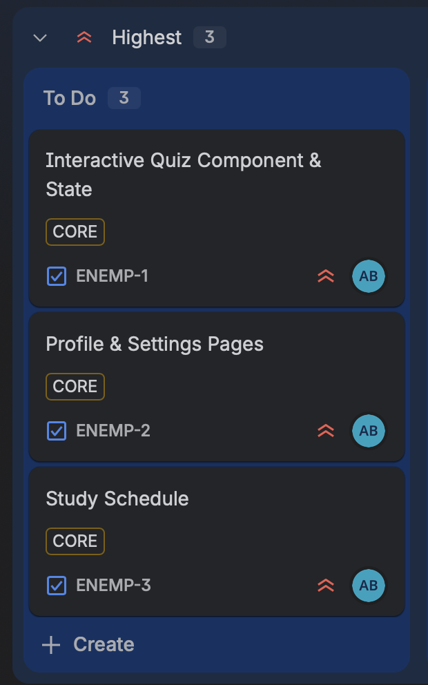
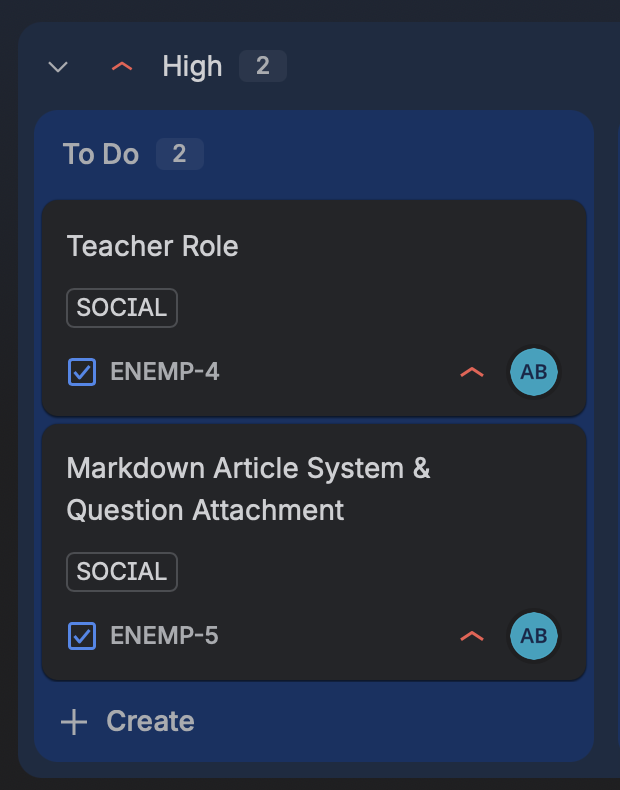
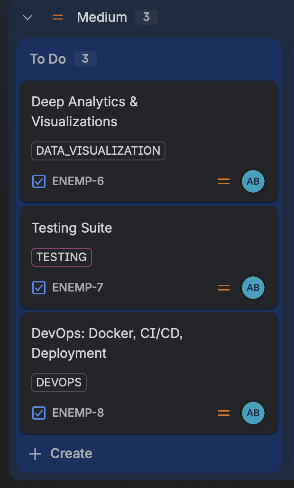
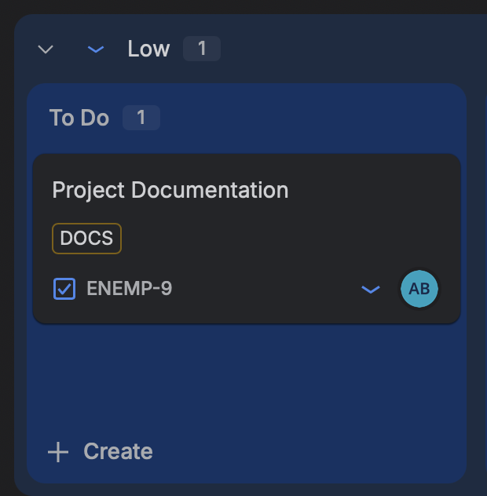

# Registro de Acompanhamento - 10/08/2026

**Projeto:** Website para auxiliar estudantes do ENEM
**Estudante:** Ana Beatriz Rangel Mattos
**Status:** Em Desenvolvimento (Fase de Implementação de Funcionalidades e Perfil)

## 1. O que foi desenvolvido durante este período?

- **Planejamento e Gestão de Escopo no Jira:** Estruturação, quebra de tarefas e organização do backlog do projeto na plataforma Jira.
- **Funcionalidades de Questão Única e Resolução:** Implementação do fluxo de resolução de questão individual e integração com o envio de resposta.
- **Histórico de Questões Resolvidas:** Desenvolvimento das telas e rotas (`/history` e `/history/[id]`) para listagem e detalhamento do histórico de exercícios solucionados pelo estudante.
- **Perfil do Usuário:** Criação da estrutura base, layouts e rotas (`/profile`) para a página de perfil do usuário.

## 2. Quantidade de horas

### 2.1 Horas Alcançadas

- **Ana Beatriz:** Total 11:40 horas.

### 2.2 Horas Pretendidas

- **Ana Beatriz:** 160 horas.

## 3. Evidências de Progresso

- **Repositório GitHub:** [Projeto no GitHub](https://github.com/ana-rangel-mattos/enem-prep-platform)
- **Gerenciamento de projeto no Jira:** [Projeto Jira](https://enemprep.atlassian.net/jira/core/projects/ENEMP/board?filter=&groupBy=priority&atlOrigin=eyJpIjoiZTQ0YjE0YjIyMDdkNGRjZGI3NDk4NGM0MTkwOTlhY2MiLCJwIjoiaiJ9)
    - Screenshots:
    
    
    
    

## 4. Quais foram os principais avanços?

- **Rastreabilidade de Desempenho:** O estudante agora consegue responder a questões de forma isolada e consultar o histórico completo de questões já resolvidas com seus respectivos detalhes.
- **Organização do Escopo de Desenvolvimento:** Mapeamento completo das histórias e tarefas no Jira, permitindo melhor acompanhamento visual do progresso do projeto.
- **Expansão da Interface de Navegação:** Criação e estruturação das rotas de histórico e perfil, ampliando a usabilidade e a navegação dentro da plataforma.

## 5. Quais dificuldades você encontrou?

- **Mapeamento e Integração de Dados de Histórico:** Ajustes necessários nos DTOs e serviços do back-end (`GetSolvedQuestionDto`, `SolvedQuestionsService`) e no front-end para garantir que os dados do histórico fossem resgatados e exibidos corretamente.
- **Gestão do Tempo:** Necessidade de organizar e estimar com precisão tarefas menores de interface e refatoração para manter o progresso fluido sem comprometer o planejamento do escopo.

## 6. O que planeja fazer até o próximo check-in?

- **Desenvolvimento da Funcionalidade de Simulados (`ExamRunner`):** Implementação completa do componente e do fluxo de navegação/execução de simulados com múltiplas questões no front-end.
- **Integração com o Motor de Pontuação:** Conectar a interface de simulados aos endpoints do back-end em .NET para envio de respostas em lote e exibição do cálculo final de desempenho.
- **Conclusão da Página de Perfil (`/profile`):** Finalizar a interface de perfil do usuário, exibindo as informações cadastrais e métricas consolidadas do estudante.